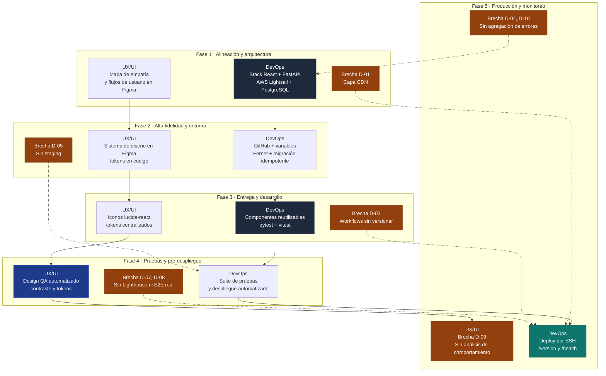

# Flujo de Diseño (UX/UI) y Flujo de Despliegue Técnico (Ingeniería y DevOps)

**Proyecto:** RevolutionMedia.AI — Plataforma de agentes de voz en la nube
**Alcance:** Frontend `AgentsAi_Frontend` y backend `Agent_IA_Server`
**Stack:** React 18 + Vite 4 + Tailwind 3 + MUI 7 (frontend) / FastAPI + Python 3.11 (backend)
**Infraestructura:** AWS Lightsail (instancia única, nginx) + PostgreSQL en la misma instancia
**Integración continua:** GitHub Actions con despliegue por SSH
**Fecha:** Noviembre de 2026

---

## 1. Alcance y Método

El presente documento describe el ciclo de trabajo completo de RevolutionMedia.AI organizado en las cinco fases del proceso de diseño y despliegue: **alineación inicial y arquitectura**, **diseño de alta fidelidad y configuración del entorno**, **entrega y desarrollo**, **pruebas y pre-despliegue**, y **despliegue en producción con monitoreo continuo**.

Cada fase se documenta bajo dos flujos paralelos:

- **Flujo de Diseño (UX/UI):** investigación con el usuario, arquitectura de información, sistema de diseño, prototipado, entrega de assets y control de calidad visual.
- **Flujo de Despliegue Técnico (Ingeniería y DevOps):** definición de stack, arquitectura de despliegue, gestión de entornos, automatización, verificación y operación en producción.

La particularidad de este documento es que **no describe un proceso idealizado**: cada afirmación se contrasta con el estado verificable del código en la fecha de redacción. Las secciones *Estado actual* describen lo que existe y es auditable en el repositorio; las secciones *Brecha* identifican lo que la fase exige y el proyecto todavía no cubre. La sección 8 consolida esas brechas en una matriz priorizada.

Criterio de evidencia empleado:

| Tipo de evidencia | Descripción | Ejemplo en el proyecto |
| :--- | :--- | :--- |
| Artefacto de código | Fichero versionado que implementa la práctica | `src/components/admin/Button.jsx` |
| Prueba automatizada | Test que falla si la práctica se rompe | `src/components/admin/Button.contrast.test.js` |
| Configuración de infraestructura | Fichero que declara el entorno de ejecución | `Dockerfile`, `start.sh`, `railway.toml` |
| Ausencia verificada | Práctica no presente en el repositorio | ausencia de `.github/workflows` en ambos repositorios |

---

## 2. Panorama Real de la Plataforma

| Capa | Tecnología | Ubicación / evidencia |
| :--- | :--- | :--- |
| Interfaz | React 18.2, React Router 7, Vite 4 | `AgentsAi_Frontend/package.json`, `src/` |
| Estilos | Tailwind CSS 3.4, MUI 7.3, Emotion | `tailwind.config.js`, `src/styles/themeMui.js` |
| Interacción | `@dnd-kit` (reordenación), `framer-motion`, `lucide-react` | `src/components/common/TransferChainOrder.jsx` |
| Pruebas FE | Vitest 4 + Testing Library (jsdom) | `vitest.config.js`, `src/**/*.test.jsx` |
| Humo FE | Script Node sobre la API real | `scripts/smoke-tools.mjs` |
| API | FastAPI + Uvicorn, Python 3.11 | `Agent_IA_Server/main.py` → `STT_server/STT_Server.py` |
| Audio | `webrtcvad`, `numpy`, WebSocket bidireccional | `STT_server/services/audio_ingest.py` |
| Datos | PostgreSQL (psycopg2, pool 1–10) | `STT_server/db.py` |
| Esquema | Migraciones `.sql` idempotentes `001`–`030` | `db/migrations/` |
| Pruebas BE | Pytest (`asyncio_mode=auto`), Ruff | `pytest.ini`, `ruff.toml` |
| Empaquetado | Docker multi-stage, usuario no-root `app` (uid 1001) | `Dockerfile` (ambos repos) |
| Arranque | `start.sh`: migra, hace backfill y ejecuta Uvicorn | `start.sh` |
| Entrada en producción | GitHub Actions → despliegue por SSH a Lightsail | fuera del árbol versionado (ver Brecha D-03) |
| Servidor web | nginx: TLS, estáticos del SPA y proxy inverso a Uvicorn | configuración del servidor (ver Brecha D-01) |
| Base de datos | PostgreSQL en la instancia Lightsail | `DATABASE_URL` |
| Trazabilidad de versión | `GET /version` expone `GIT_SHA` y `BUILD_STARTED_AT` | `STT_server/routes/api.py:466` |

---

## 3. Fase 1 — Alineación Inicial y Arquitectura

### 3.1 Flujo de Diseño (UX/UI)

**Qué exige la fase.** Mapa de empatía y flujos de usuario en un tablero colaborativo en la nube; definición de la arquitectura de información y de wireframes de baja fidelidad.

**Estado actual.** La investigación con usuarios y los flujos de usuario se elaboran en **Figma**, que es la herramienta de diseño en uso para el proyecto. La arquitectura de información está consolidada en el enrutador de `react-router-dom`, donde cada superficie administrativa —agentes, herramientas, integraciones, números telefónicos, ajustes— corresponde a una ruta estable y a un módulo de `src/pages/`. Los wireframes de baja fidelidad se resolvieron en Figma antes de la construcción de los modales y las páginas.

La validación del mapa de bersaing se apoya en el comportamiento real de la plataforma de voz: la ruta de una llamada atraviesa un agente configurado con prompt propio, idioma, voz, herramientas, cadena de transferencia y tiempos de silencio. Ese recorrido es el objeto de estudio de la sesión de investigación.

**Brecha.** No existe un artefacto versionado que fije los flujos de usuario; el mapa de empatía reside únicamente en Figma. Una reorganización del panel que invalide los flujos no deja rastro en el control de versiones, lo que impide auditar la distancia entre el diseño previsto y la interfaz construida.

### 3.2 Flujo de Despliegue Técnico

**Qué exige la fase.** Elección del framework de frontend y del proveedor de nube; planificación de la entrega de contenido mediante una red de distribución (CDN) para carga rápida global.

**Estado actual.** El stack quedó definido y es coherente con el producto: React 18 con Vite 4 como compilador, Tailwind CSS y MUI 7 como sistema de estilos, FastAPI con Python 3.11 como backend, PostgreSQL como almacén de datos y Docker como formato de distribución. El proveedor de nube es **AWS Lightsail**, con una instancia única que aloja el backend y el servidor web nginx, y PostgreSQL instalado en la misma instancia.

La decisión tiene consecuencias operativas directas. Una instancia única significa un único punto de fallo: una caída del host detiene simultáneamente la interfaz, la API y la base de datos. La separación de responsabilidades dentro de la instancia compensa parcialmente este riesgo, y es la razón de que el backend se ejecute como usuario no-root y el despliegue se apoye en contenedores con imagen mínima (`python:3.11-slim`, `node:20-alpine`).

**Brecha.** No existe una capa de CDN. Todo el tráfico de la interfaz se origina en una única región de AWS, de modo que la distancia física del usuario determina el tiempo de primer byte de la aplicación. El requisito de la fase —carga rápida global— no se satisface hoy. La solución natural es CloudFront delante de la instancia, con el origen restringido a las IP de Lightsail y un certificado ACM en el borde.

---

## 4. Fase 2 — Diseño de Alta Fidelidad y Configuración del Entorno

### 4.1 Flujo de Diseño (UX/UI)

**Qué exige la fase.** Sistema de diseño centralizado en la nube (Figma) con componentes reutilizables: botones, formularios, tipografías; prototipado de alta fidelidad con transiciones interactivas.

**Estado actual.** Figma aloja el sistema de diseño de alta fidelidad y el prototipo navegable. En el código, ese sistema tiene su expresión en un nivel de componentes propio: `src/components/admin/` agrupa `Button.jsx` (con las variantes primaria y secundaria resueltas por props en lugar de por duplicación), `PrimaryButton.jsx`, `SecondaryButton.jsx` y `ModalActions.jsx`, todos exportados desde `src/components/admin/index.js`. Los tokens de color, tipografía y espaciado viven en `src/styles/themeMui.js` y `src/index.css`, y las transiciones interactivas se resuelven con `framer-motion` y con los estados de `hover`/`focus` definidos sobre los tokens.

Un rasgo distintivo del proyecto es que **la conformidad del diseño no se verifica por inspección visual, sino por prueba automatizada**. `Button.contrast.test.js` calcula la relación de contraste de cada estado del botón y falla si baja del umbral AA; `buttonTokens.test.js` y `themeMui.buttons.test.js` comprueban que los tokens publicados en el tema coincidan con los valores esperados; `index.theme.test.js` valida la capa de tema global; y `primaryCtaMigration.test.jsx` impide la reaparición de botones primarios construidos a mano fuera del componente compartido. Esto convierte el control de calidad del diseño en un control de calidad automatizado y reproducible.

**Brecha.** La correspondencia entre el diseño de Figma y el código no está verificada de forma mecánica: no existe un archivo que declare el mapping Figma–componente, ni una prueba que compare medidas o colores exportados contra los tokens del repositorio. La verificación es bidireccional: la corrección del código se comprueba, pero la desviación del diseño respecto al código no.

### 4.2 Flujo de Despliegue Técnico

**Qué exige la fase.** Creación del proyecto en un sistema de control de versiones en la nube; configuración de las variables de entorno para desarrollo, con claves de API y URLs de servidor de prueba.

**Estado actual.** Ambos proyectos residen en GitHub bajo la organización `RevolutionMedia-AI`: `AgentsAi_Frontend` y `Agent_IA_Server`, con rama `main` como主干 y despliegue directo desde ella. La configuración de entorno se apoya en tres mecanismos complementarios:

1. **Plantilla de variables.** `.env.example` documenta las variables de despliegue con su propósito; los archivos `.env` reales están fuera del control de versiones.
2. **Resolución por usuario.** Las credenciales de proveedores de terceros (OpenAI, Anthropic, ElevenLabs, Inworld, AssemblyAI, Rime, Twilio) no viven en el entorno: se cifran en la base de datos mediante Fernet con la clave `CREDENTIAL_ENCRYPTION_KEY`, y `STT_server/services/credentials_resolver.py` las resuelve por sesión.
3. **Construcción parametrizada.** `VITE_API_URL` se hornea en el bundle del frontend en tiempo de compilación (argumento `ARG` del `Dockerfile` del frontend), y `GIT_SHA` se graba en la imagen del backend para que `GET /version` demuestre qué commit está en ejecución.

El arranque del contenedor es determinista: `start.sh` genera el administrador inicial a partir de `BOOTSTRAP_ADMIN_PASSWORD`, aplica las migraciones pendientes y ejecuta el backfill de los datos JSON heredados hacia PostgreSQL antes de levantar Uvicorn. Las tres operaciones son idempotentes y el script aborta el arranque si una migración falla de forma no idempotente, de modo que un despliegue corrupto se declara fallido en lugar de servir en estado inconsistente.

**Brecha.** La separación de entornos no está implementada. No hay configuración diferenciada para desarrollo, preproducción y producción más allá del conjunto de variables de cada servicio; no existe un ambiente de staging. El proceso de migración automática en el arranque refuerza esta carencia: el mismo artefacto modifica el esquema de la base de datos de producción en el mismo instante en que sirve tráfico.

---

## 5. Fase 3 — La Entrega (Design Handoff) y Desarrollo

### 5.1 Flujo de Diseño (UX/UI)

**Qué exige la fase.** Exportación y organización de iconos, imágenes y estilos de color; entrega de las medidas exactas, fuentes y propiedades CSS mediante herramienta de inspección.

**Estado actual.** Los iconos provienen de `lucide-react` como dependencia de producción, lo que garantiza un trazo y un peso de línea coherentes en toda la interfaz y evita la exportación manual de SVG desde Figma. Los estilos de color están centralizados como tokens en `src/index.css` y en el tema de MUI, y las fuentes se declaran de forma centralizada. La especificación técnica de medidas y propiedades CSS es innecesaria en la práctica: el diseño está expresado directamente en tokens de código, de modo que el valor en Figma y el valor en la hoja de estilos son el mismo objeto.

**Brecha.** No existe un inventario versionado de assets que documente qué recurso visual proviene de qué archivo de Figma. La trazabilidad entre el diseño aprobado y el recurso exportado depende de la disciplina individual, no del repositorio.

### 5.2 Flujo de Despliegue Técnico

**Qué exige la fase.** Traducción de los componentes visuales a código limpio y reutilizable; automatización de la integración continua que compila el proyecto y detecta errores de sintaxis en cada incorporación de código.

**Estado actual.** El frontend está organizado por responsabilidad: `src/components/common/` para componentes de dominio, `src/components/admin/` para el sistema de diseño, `src/pages/` para las superficies de negocio, `src/hooks/`, `src/services/` y `src/utils/` para las capas transversales. Los componentes complexos contienen lógica propia y pruebas en fichero contiguo (por ejemplo `TransferChainOrder.jsx` con `TransferChainOrder.test.jsx`, o `AiFirstDatesPicker.jsx` con su test), lo que permite refactorizar sin Fear.

En el backend, el diseño es modular y verificable: `STT_server/services/` aloja la lógica de dominio por servicio (audio, turnos, reproducción, cascada de transferencia, credenciales), `STT_server/adapters/` aísla cada proveedor externo, `STT_server/domain/` contiene las entidades y funciones puras, y `STT_server/routes/` expone la API. La separación adaptador/dominio es lo que permite añadir proveedores (AssemblyAI, Inworld, Rime, ElevenLabs) sin alterar el núcleo.

La automatización existe en dos niveles. El primero es la integración continua local: `pytest` con `ruff` en el backend y `vitest` en el frontend, con el harness de humo `scripts/smoke-tools.mjs` para validar contra la API real. El segundo es el despliegue: **GitHub Actions** compila ambos artefactos, ejecuta la verificación y despliega por SSH a la instancia Lightsail.

**Brecha.** Los ficheros de workflow de GitHub Actions no están versionados en ninguno de los dos repositorios. La configuración efectiva del pipeline —qué ramas disparan, qué pasos se ejecutan, cómo se autentica el SSH, cómo se rotan las credenciales— reside en la configuración del repositorio en GitHub y no en el árbol de código. Una reorganización de la cuenta, o un nuevo colaborador sin permisos de administración, deja la definición del despliegue fuera del control de versiones y sin posibilidad de revisión.

---

## 6. Fase 4 — Pruebas, Revisión en Contexto y Pre-despliegue

### 6.1 Flujo de Diseño (UX/UI)

**Qué exige la fase.** El diseñador revisa la interfaz programada y deja comentarios o reporta discrepancias visuales en una plataforma de revisión.

**Estado actual.** La revisión de la calidad del diseño se ha resuelto dentro del propio repositorio, con un criterio automatizado en lugar de un proceso de inspección visual. El conjunto de pruebas del frontend cubre el contraste de los botones (`Button.contrast.test.js`), la coherencia de tokens (`buttonTokens.test.js`, `themeMui.buttons.test.js`), la unicidad de los componentes de CTA (`primaryCtaMigration.test.jsx`), la Fluent de los modales de agente (`agentModalCopy.language.test.js`), el flujo de integraciones de extremo a extremo en el DOM (`IntegrationsPage.e2e.test.jsx`) y la vista por agente (`IntegrationsPage.byAgent.test.jsx`). Un componente que se aparta de las reglas del sistema rompe una prueba concreta con un mensaje que identifica el incumplimiento.

Esta estrategia tiene una limitación recognised: las pruebas verifican las reglas que se escribieron, no la apariencia percibida. Un espaciado que el diseñador considera excesivo y que ninguna regla codifica atraviesa todas las pruebas sin ser detectado.

**Brecha.** No existe un mecanismo de comentarios sobre la interfaz implementada, ni una revisión visual previa al despliegue. La figura del «diseño QA» se resuelve con cobertura automatizada de reglas, con un vacío para las desviaciones que dependen del juicio visual.

### 6.2 Flujo de Despliegue Técnico

**Qué exige la fase.** Despliegues intermedios con enlace de vista previa automático por cambio; pruebas automatizadas de rendimiento, accesibilidad y de extremo a extremo ejecutadas en la nube.

**Estado actual.** La verificación automatizada es sólida en el nivel de componente y de integración. El backend dispone de una suite de pytest que cubre el núcleo del producto —enrutamiento de llamadas, orden de traspaso, invariantes de la cascada de transferencia, contrato de herramientas, cierre por despedida, calidad de audio, tiempos de latencia de STT— y que reúne 1.944 pruebas recopiladas. El frontend cubre con Vitest los flujos de página, la reordenación por arrastre y la validación de formularios.

La cadena de despliegue, sin embargo, es lineal: `main` → servidor de producción. No hay generación de enlace de vista previa. Cada cambio se valida únicamente ejecutando las pruebas y, si pasan, desplegando.

**Brecha.** Tres ausencias concretas. Primera: no existe un ambiente de preproducción ni un enlace de vista previa, de modo que la validación visual de un cambio exige llegar a producción. Segunda: no hay auditoría automatizada de accesibilidad ni de rendimiento en la canalización; el contraste se comprueba, pero el peso del bundle, los Core Web Vitals y el orden de los recursos no. Tercera: no hay pruebas de extremo a extremo con navegador real (Playwright o equivalente); las pruebas de flujo del frontend operan sobre jsdom, que no reproduce la composición real ni la temporización de la interfaz.

La segunda ausencia produjo un efecto medible: **la suite del backend llevaba semanas sin ejecutarse**. Un error de recolección en un fichero de pruebas abortaba la ejecución completa —cero pruebas ejecutadas— sin que nada lo señalara, porque el único ejecutor de la suite es la persona que la lanza a mano. La corrección del error de recolección y de once expectativas desactualizadas devolvió a verde el conjunto (1.943 pruebas en verde, 1 omitida), pero el episodio es la demostración de que la brecha D-03 no es teórica: sin ejecución automática, la suite es un documento, no una barrera.

---

## 7. Fase 5 — Despliegue en Producción y Monitoreo Continuo

### 7.1 Flujo de Diseño (UX/UI)

**Qué exige la fase.** Análisis del comportamiento real mediante herramienta de análisis en la nube; iteración basada en datos objetivos.

**Estado actual.** No hay instrumentación de comportamiento de usuario. Los datos disponibles son de servidor, no de interacción: el backend registra por llamada el resumen `CALL_SUMMARY` con contadores, galgas y latencias observadas, y el endpoint `GET /dashboard/stats` agrega la actividad de la cuenta. Esta información alimenta el panel interno, pero no existe una herramienta que capture la sesión del usuario en la interfaz —donde abandonan, dónde se equivocan, qué flujo abandona.

**Brecha.** Falta la fuente de datos propia de esta fase. Sin ella, la iteración se apoya en la percepción del equipo y en las quejas de los usuarios finales, no en el comportamiento observado.

### 7.2 Flujo de Despliegue Técnico

**Qué exige la fase.** Despliegue continuo a producción, actualización de la distribución de contenido sin interrupción del servicio, y monitoreo técnico que capture errores en tiempo real y mida tiempos de carga.

**Estado actual.** El despliegue es automatizado: GitHub Actions construye las imágenes, las transfiere a la instancia Lightsail y las reinicia. La actualización del frontend no interrumpe el servicio porque el bundle es un conjunto de ficheros estáticos versionados por hash: nginx sirve la nueva versión en cuanto los ficheros están en disco, y la aplicación en caché del navegador garantiza que cada cliente siga viendo un bundle coherente. El backend sí sufre una ventana de reinicio, mitigada por el reinicio controlado del contenedor y la ausencia de estado en proceso que sobreviva al reinicio (el estado de llamada vive en memoria y las llamadas en curso se pierden de forma acotada y esperable).

La observabilidad se apoya hoy en el registro estructurado de la aplicación, con niveles `info` y `warning` bien diferenciados y marcas de correlación por `session_key` y `call_sid`. A ello se suma la trazabilidad de despliegue: `GET /version` devuelve el commit y la marca de arranque, y `GET /health` comprueba la conectividad con PostgreSQL, de modo que un verificador externo puede confirmar que la instancia en servicio corresponde al commit esperado y que su base de datos responde. El endpoint de diagnóstico de llamadas `/api/sessions` expone las sesiones activas.

**Brecha.** El punto ciego es la ausencia de agregación de errores. Los `log.exception` y `log.warning` escriben en la salida estándar del contenedor, sin retención estructurado, sin traza distribuida y sin agrupación de errores por causa. Cuando el backend falla, el síntoma aparece en el texto del log que alguien lee a mano y no en una notificación. Tampoco existe un agregador de métricas de infraestructura —CPU, memoria, conexiones de PostgreSQL, saturación del pool— que permita anticipar el agotamiento de recursos. La orquestación de llamadas es una carga de Streaming WebSocket de larga duración; su perfil de fallo característico —pool de conexiones agotado, memoria creciente por sesión viva— es invisible sin instrumentación de proceso.

---

## 8. Matriz de Brechas Consolidada

| Id | Fase | Brecha | Impacto | Acción propuesta | Prioridad |
| :--- | :--- | :--- | :--- | :--- | :--- |
| D-01 | 1 | Sin capa CDN: la interfaz se sirve desde una única región | Latencia de carga proporcional a la distancia del usuario | CloudFront delante de Lightsail, origen restringido a las IP de la instancia, certificado ACM | Alta |
| D-02 | 1, 5 | PostgreSQL comparte instancia con la aplicación | Una caída del host detiene interfaz, API y base de datos; un reinicio por despliegue afecta a la base | Migrar a RDS en subred privada con réplica y ventanas de mantenimiento gestionadas; a corto plazo, `pg_dump` programado con rotación a S3 y restauración probada | Alta |
| D-03 | 3 | Los workflows de GitHub Actions no están versionados y la suite no se ejecuta en el pipeline | La definición del despliegue es irreproducible; una regresión de recolección permaneció semanas sin ser vista por nadie | Incorporar `.github/workflows/` a ambos repositorios con el pipeline real (build, `pytest`, `ruff`, `vitest`, despliegue por SSH), documentando disparadores, pasos y rotación de credenciales | Alta |
| D-04 | 5 | Sin agregación de errores ni traza | Los fallos en runtime solo se detectan leyendo el log del contenedor | Sentry en frontend y backend, o captura de errores equivalente con retención y agrupación por causa | Alta |
| D-05 | 2, 4 | Sin ambiente de staging ni enlace de vista previa | Todo cambio llega a producción sin validación visual intermedia | Instancia de preproducción sobre el mismo esquema Lightsail, o vista previa del frontend con Netlify/Vercel en las ramas de trabajo | Media |
| D-06 | 5 | Migraciones aplicadas en el arranque del contenedor | El despliegue modifica el esquema y sirve tráfico en el mismo instante, sin ventana de control | Separar el paso `migrate` del paso `start` y ejecutarlos como tareas distintas en el pipeline; conservar el fallo rápido del arranque | Media |
| D-07 | 4 | Sin auditoría de accesibilidad ni de rendimiento en la canalización | Las regresiones de contraste se detectan, las de rendimiento y peso de bundle no | Lighthouse CI sobre la vista previa; fijar presupuestos de tamaño de bundle | Media |
| D-08 | 4 | Sin pruebas de extremo a extremo con navegador real | Los flujos se validan sobre jsdom, que no reproduce composición ni temporización | Playwright sobre los recorridos críticos: alta de agente, conexión de integración, transferencia | Media |
| D-09 | 5 | Sin instrumentación de comportamiento de usuario | La iteración de UX no se apoya en datos de interacción | Hotjar o equivalente con mapa de calor y embudos sobre los flujos de alta y de integraciones | Media |
| D-10 | 5 | Sin métricas de infraestructura | El agotamiento del pool de conexiones o la fuga de memoria no son visibles | Recolector de métricas del proceso y del host, con alertas por umbral | Media |
| D-11 | 3 | Sin pipeline de migraciones versionado | El esquema no se revisa antes de aplicarse | Adoptar Alembic para que cada cambio de esquema sea un *commit* revisable | Baja |
| D-12 | 1, 3 | Artefactos de investigación y de mapping Figma–código fuera del repositorio | No es auditable la distancia entre diseño previsto e interfaz construida | Exportar los mapas de empatía y el mapping de tokens a un directorio de documentación versionado | Baja |

---

## 9. Diagrama del Ciclo Completo

**Lectura del diagrama.** Las dos cadenas superiores —diseño e ingeniería— avanzan en paralelo y cada una alimenta a la siguiente. Las brechas señaladas en ámbar no cortan el flujo, pero se acumulan en la Fase 5: en ausencia de CDN, de versionado del pipeline, de agregación de errores y de métricas de infraestructura, cada incremento de la interfaz se entrega sin una red de seguridad operativa proporcional. La retroalimentación punteada hacia la Fase 1 expresa que el conocimiento recopilado en producción —una vez que exista instrumentación de comportamiento— debe reentrar en la definición de la arquitectura y de los flujos de usuario.

---

## 10. Composición del Entorno de Producción

Elementos que configuran la instancia Lightsail y su relación con los repositorios.

| Recurso | Responsabilidad | Verificación |
| :--- | :--- | :--- |
| nginx | Terminación TLS, servicio del bundle SPA con reserva a `index.html`, proxy inverso de la API y del WebSocket de audio hacia Uvicorn en `127.0.0.1:8080` | `GET /` y `GET /version` a través del dominio |
| Uvicorn | API HTTP y WebSocket de audio (`POST /voice`, `WS /media-stream`) | `GET /health` con comprobación de PostgreSQL |
| Contenedor del backend | Imagen `python:3.11-slim`, usuario `app` (uid 1001), puerto 8080 | `GET /version` devuelve el `GIT_SHA` esperado |
| Contenedor del frontend | Imagen `node:20-alpine`, `serve -s dist` en el puerto 3000 | carga del bundle y ausencia de errores 404 de assets |
| PostgreSQL | Almacén de datos, migraciones de `db/migrations/` aplicadas en el arranque | tabla `users` sembrada y esquema completo tras el despliegue |
| Secretos | `DATABASE_URL`, `CREDENTIAL_ENCRYPTION_KEY`, `BOOTSTRAP_ADMIN_PASSWORD`, `PUBLIC_URL`, `ALLOWED_ORIGINS` | arranque sin advertencias de `oauth.boot` ni `missing env vars` |
| GitHub Actions | Compilación, verificación y despliegue por SSH | estado verde del workflow y `GIT_SHA` coincidente en `/version` |

Rutas que deben ser públicas en el dominio de la API, por encontrarse detrás de la terminación TLS de nginx:

- `POST /voice` — webhook de Twilio que devuelve el TwiML de la llamada.
- `WS /media-stream` — WebSocket de audio bidireccional que Twilio abre durante la llamada.
- `POST /voice/cascade` — reentrada de la cascada previa a la IA.
- `POST /voice/transfer-fallback` — continuación de la cadena de transferencia cuando el destino no atiende.
- `POST /call-status` — notificación de cambio de estado de la llamada.
- `GET /version` y `GET /health` — verificación de despliegue y de disponibilidad.

El proxy de nginx debe preservar las cabeceras `Upgrade` y `Connection` para la ruta del WebSocket; sin ellas, el handshake de `/media-stream` falla y la llamada entra sin audio de entrada.

---

## 11. Checklist de Despliegue

**Antes del despliegue**

1. `pytest` y `ruff` en verde en el backend.
2. `npm run test` (Vitest) y `npm run test:smoke` en verde en el frontend.
3. El commit a desplegar es el que la rama `main` señala, sin trabajo sin confirmar en el árbol local.
4. La instancia tiene espacio en disco para la nueva imagen y para el dump de PostgreSQL.

**Durante el despliegue**

5. La canalización construye las dos imágenes y las transfiere por SCP.
6. `start.sh` aplica las migraciones; si alguna falla de forma no idempotente, el arranque se aborta y el despliegue se declara fallido.
7. El backend reinicia y `GET /health` confirma la conectividad con PostgreSQL.
8. `GET /version` devuelve el `GIT_SHA` del commit desplegado y una `BUILD_STARTED_AT` posterior al reinicio.

**Después del despliegue**

9. La carga de la interfaz no produce errores 404 de assets versionados.
10. Una llamada de prueba completa el ciclo: saludo del agente, respuesta del usuario, transferencia si procede y cierre.
11. `GET /sessions` no muestra sesiones huérfanas del despliegue anterior.

**En caso de fallo**

12. Revertir al commit anterior y volver a desplegar; las migraciones aplicadas son idempotentes, por lo que un reintento no deja el esquema en estado inconsistente.
13. Si el fallo es de esquema y no de código, restaurar desde el dump previo a la migración.

---

## 12. Conclusión

El proyecto RevolutionMedia.AI sostiene un ciclo de desarrollo verificado en sus dos dimensiones. En el flujo de diseño, la conformidad del sistema de diseño no depende de la inspección visual sino de pruebas que verifican contraste, tokens y unicidad de los componentes de llamada a la acción. En el flujo técnico, la suite de pruebas del backend cubre el dominio completo del producto —enrutamiento de llamadas, cascada de transferencia, ciclo de audio y contrato de herramientas— y la automatización llega hasta el despliegue.

Lo que el proyecto todavía no sostiene es la capa operativa del ciclo. La ausencia de CDN, la convivencia de la base de datos con la aplicación en una única instancia, el despliegue definido fuera del control de versiones, la falta de agregación de errores y la ausencia de instrumentación de comportamiento de usuario son, en conjunto, la materialización de las brechas D-01 a D-12. Ninguna de ellas afecta a la corrección del producto; todas afectan a su resiliencia y a la capacidad de evolucionarlo con evidencia en lugar de con impresiones.

La prioridad derivada es acotada: versionar el pipeline (D-03), instrumentar el error y el proceso (D-04, D-10), desacoplar la base de datos (D-02) y poner un CDN delante de la interfaz (D-01). Las cuatro intervenciones elevan la resiliencia del proyecto sin exigir cambios en el núcleo funcional.

---

## 13. Referencias

1. Documentación interna del proyecto: `Agent_IA_Server/Documentacion-Server.md`, `Agent_IA_Server/README.md`, `AgentsAi_Frontend/README.md`.
2. `AgentsAi_Frontend/CARACTERISTICAS_UI_NUBE.md` — análisis de características de interfaz en la nube y su aplicación verificable.
3. Configuración de la interfaz: `AgentsAi_Frontend/src/components/admin/`, `AgentsAi_Frontend/src/styles/themeMui.js`, `AgentsAi_Frontend/src/index.css`.
4. Verificación de la calidad del diseño: `Button.contrast.test.js`, `buttonTokens.test.js`, `themeMui.buttons.test.js`, `index.theme.test.js`, `primaryCtaMigration.test.jsx`.
5. Arranque y migraciones: `Agent_IA_Server/start.sh`, `Agent_IA_Server/db/migrations/`.
6. Trazabilidad de despliegue: `STT_server/routes/api.py` (`/version`, `/health`), `STT_server/services/call_summary.py`.
7. Especificación de la API de streaming de audio de Twilio (Media Streams) y del flujo de webhook de voz (`POST /voice`).
